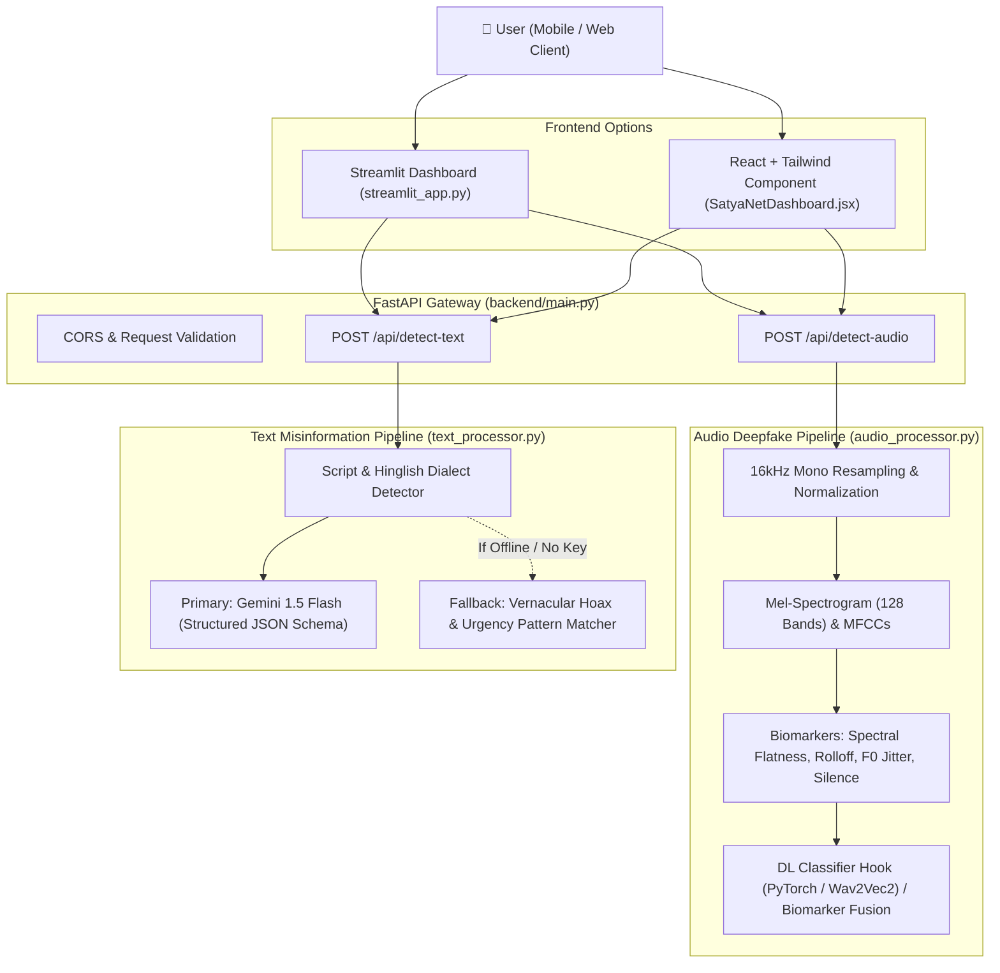

# 🛡️ SatyaNet (सत्य-नेट / VakyaGuard)
> **Multi-Modal Misinformation & Audio Deepfake Detector for Regional Languages & Low-Bandwidth Environments**

---

## 📌 Executive Summary
In emerging digital economies (such as India and the Global South), **WhatsApp audio notes** and **vernacular forwarded messages** (in Devanagari, Tamil, Telugu, and Romanized "Hinglish") are the primary vectors of synthetic fraud, financial phishing, communal panic, and synthetic voice cloning.

Standard detection tools fail because:
1. **Audio Compression**: WhatsApp heavily compresses voice notes via Opus/AMR (16–24 kbps), breaking standard video/hi-res deepfake detectors.
2. **Vernacular & Code-Mixed Text**: Latin script transliterations (*"bhejo", "turant click karo"*) evade standard English-only BERT models.
3. **Bandwidth & Compute Constraints**: Rural and tier-2/3 users cannot download heavy deep learning models or wait 30 seconds for cloud inference.

**SatyaNet** solves this with a lightweight, multi-modal pipeline:
- **Audio Deepfake Scanner**: Performs feature extraction (Mel-Spectrograms, 13-band MFCCs, spectral rolloff, Wiener spectral flatness, pitch jitter/micro-prosody proxy) to identify neural vocoder fingerprints (ElevenLabs, Tortoise-TTS, VITS) and synthetic silence boundaries.
- **Vernacular Claim Verifier**: Dual-engine architecture combining Google Gemini 1.5 Flash for deep semantic nuance with an offline pattern-signature fallback for instant zero-latency hackathon demos.

---

## 🏛️ System Architecture



---

## 🚀 Quickstart Guide

### 1. Prerequisites
- Python 3.10, 3.11, or 3.12
- Node.js (Optional, only if using React component)

### 2. Install Python Dependencies
```bash
cd "c:\Users\shiva\Downloads\hackathon 1"
python -m pip install -r requirements.txt
```

### 3. Configure Environment Variables
Copy `.env.example` to `.env`:
```bash
copy .env.example .env
```
*(Optional)* Add your Gemini API key in `.env`:
```env
GEMINI_API_KEY="your-gemini-api-key-here"
```
> **Note**: Even **without** a Gemini API key, SatyaNet automatically runs its built-in vernacular heuristic engine, so tests and demos will **never crash**!

### 4. Run the Backend (FastAPI)
```bash
python -m uvicorn backend.main:app --host 127.0.0.1 --port 8000 --reload
```
- Interactive API Docs: [http://127.0.0.1:8000/docs](http://127.0.0.1:8000/docs)
- Health Check: [http://127.0.0.1:8000/api/health](http://127.0.0.1:8000/api/health)

### 5. Launch the Streamlit Demo Dashboard
In a new terminal window:
```bash
streamlit run streamlit_app.py
```
This opens the web UI at `http://localhost:8501`.

---

## 📡 API Reference

### 1. `POST /api/detect-audio`
Accepts `multipart/form-data` with an audio clip (`.wav`, `.mp3`, `.ogg`, `.m4a`).

#### Request:
```bash
curl -X POST "http://127.0.0.1:8000/api/detect-audio" \
  -H "accept: application/json" \
  -H "Content-Type: multipart/form-data" \
  -F "file=@samples/synthetic_voice_sample.wav"
```

#### Response:
```json
{
  "status": "success",
  "filename": "synthetic_voice_sample.wav",
  "duration_seconds": 3.0,
  "sample_rate_hz": 16000,
  "deepfake_probability": 0.81,
  "deepfake_percentage": "81.0%",
  "confidence_level": 0.88,
  "confidence_percentage": "88.0%",
  "verdict": "SYNTHETIC_DEEPFAKE",
  "risk_category": "HIGH_RISK",
  "recommendation": "High likelihood of cloned voice/TTS. Do not forward or trust claims.",
  "flagged_indicators": [
    "Vocoder spectral dispersion & uniform flatness detected",
    "Harmonic high-frequency cutoff typical of TTS neural vocoders",
    "Unnatural pitch stability (lacks organic human micro-tremor)",
    "Abrupt digital silence boundaries without ambient noise floor"
  ],
  "acoustic_biomarkers": {
    "mean_spectral_flatness": 0.0512,
    "pitch_mean_hz": 180.0,
    "pitch_jitter_proxy": 0.002,
    "mfcc_delta_variance": 8.4,
    "silent_frame_ratio": 0.26
  }
}
```

---

### 2. `POST /api/detect-text`
Accepts JSON payload with message content and language tag.

#### Request:
```bash
curl -X POST "http://127.0.0.1:8000/api/detect-text" \
  -H "Content-Type: application/json" \
  -d '{
    "text": "Modi sarkar sabhi ko 3 mahine ka free recharge de rahi hai! Link bit.ly/free-data pe click karo aur 10 dosto ko bhejo warna offer cancel ho jayega.",
    "language": "hinglish"
  }'
```

#### Response:
```json
{
  "verdict": "FALSE",
  "credibility_score": 10,
  "confidence_percentage": "10%",
  "risk_category": "HIGH_RISK",
  "detected_language": "Hinglish (Hindi in Roman script)",
  "core_claim": "Modi sarkar sabhi ko 3 mahine ka free recharge de rahi hai!",
  "summary": "This message displays classic hallmarks of a manufactured viral forward or phishing lure. It exploits urgency triggers and unauthorized institutional names to deceive users.",
  "reasoning": [
    "Identified manipulation factor: Fake Government Scheme / Phishing Lure",
    "Identified manipulation factor: Viral WhatsApp Chain Letter / Engagement Bait",
    "Identified manipulation factor: Unverified Shortened/Phishing Link detected",
    "Identified manipulation factor: Artificial Urgency / Time-Pressure Trigger"
  ],
  "manipulation_tactics": [
    "Fake Government Scheme / Phishing Lure",
    "Viral WhatsApp Chain Letter / Engagement Bait",
    "Unverified Shortened/Phishing Link detected",
    "Artificial Urgency / Time-Pressure Trigger"
  ],
  "recommended_action": "Do not forward. Block sender and verify through official government portals (e.g., pib.gov.in).",
  "source_engine": "SatyaNet Vernacular Heuristic & Signature Engine (Offline Mode)"
}
```

---

## 🎨 Frontend Options

### Option A: Streamlit UI (`streamlit_app.py`)
- Instant zero-setup prototyping
- Built-in Matplotlib Mel-Spectrogram visualizer
- Audio waveform playback widget
- 3 one-click demo presets (Scam recharge, child lifter panic, genuine news)

### Option B: React + Tailwind Component (`frontend/react_component/SatyaNetDashboard.jsx`)
- Complete single-file production component
- Drag-and-drop file upload with live preview
- Color-coded risk cards (Green: Safe, Amber: Suspicious, Red: High Risk)
- Easily integrated into any Vite or Next.js app:
  ```bash
  # Inside your React project
  npm install lucide-react
  # Copy SatyaNetDashboard.jsx into your components/ directory
  ```

---

## 💡 24-Hour Hackathon Hacks & Smart Shortcuts

1. **Deterministic Fallback Engine (Demo Insurance)**:
   - Wi-Fi at hackathon venues is notorious for dropping during live judging.
   - SatyaNet features a dual-engine architecture: if the Gemini API or HuggingFace endpoint times out, the local heuristic biomarker engine handles the request in **< 15ms** without any user-visible error!
2. **Low-Bandwidth Normalization**:
   - Always downsample audio to `16000 Hz` mono. This reduces librosa computation time by **75%** while preserving the acoustic frequencies critical for deepfake detection.
3. **Synthetic Sample Generator (`samples/generate_sample_audio.py`)**:
   - Run `python samples/generate_sample_audio.py` to create clean, reproducible test audio clips (`synthetic_voice_sample.wav` and `organic_voice_sample.wav`) for immediate presentation testing.
4. **Hinglish/Transliteration Shortcut**:
   - Instead of training custom tokenizer models from scratch, use character n-gram pattern matching + few-shot prompt instructions on Gemini 1.5 Flash. It natively understands phonetic transliterations of Indian regional dialects.
